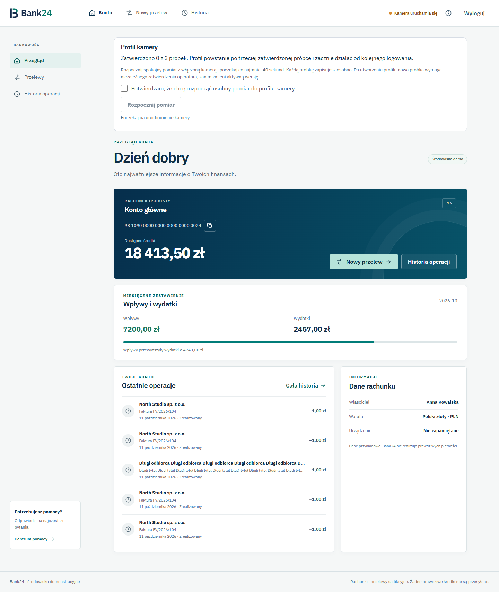

# Bank24 · HackYeah 2026

Demonstracja bankowości internetowej z analizą zachowania i opcjonalną kamerą.
React + TypeScript, Python, SQLite oraz eksperymentalny model fuzji sygnałów.
Przelewy i pieniądze w aplikacji są fikcyjne.



## Co jest w środku

| Katalog | Zawartość |
| --- | --- |
| `front/` | Aplikacja bankowa: logowanie, przelewy, historia, zgody, kamera |
| `backend/` | API banku, SQLite i serwis kamery |
| `data-collector/` | Osobna aplikacja do zbierania sesji badawczych |
| `analyses/` | Trening modeli i analizy badawcze |
| `models/` | Wagi modeli; pliki binarne obsługiwane przez Git LFS |
| `third-party/` | rPPG-Toolbox z oryginalną licencją |
| `tests/`, `docs/` | Testy integracyjne, dokumentacja API i raport weryfikacji |

## Wymagania

- Python 3.11–3.13 (weryfikacja lokalna: 3.13).
- Node.js 22.12+ lub 24 LTS oraz npm dostępne w PATH.
- Git i Git LFS, jeżeli pobierasz lub publikujesz wagi.
- Kamera i GPU są opcjonalne. Podstawowy bank działa bez nich.

## Szybki start — Windows

W katalogu projektu:

```powershell
python -m venv .venv-bank
.\.venv-bank\Scripts\python.exe -m pip install -r backend/requirements-server.txt
cd front
npm ci
npm run build
cd ..
.\.venv-bank\Scripts\python.exe backend/bank24_server.py --demo --origin http://127.0.0.1:8081
```

Otwórz **http://127.0.0.1:8081/**. Serwer podaje zbudowany frontend.

| Pole | Dane demo |
| --- | --- |
| Login | `anna.demo` |
| Hasło | `bank24` |
| Kod logowania i przelewu | `1234` |

Kod `4321` uruchamia demonstracyjny scenariusz alarmowy i odroczone wylogowanie.
Stan banku zapisuje się w `backend/data/bank24.sqlite`.

### Praca nad interfejsem

Uruchom API bez zmiany domyślnego originu:

```powershell
.\.venv-bank\Scripts\python.exe backend/bank24_server.py --demo
```

W osobnym terminalu: `cd front`, `npm run dev`, a następnie otwórz
**http://localhost:5173/**. Vite przekazuje `/api` do API na porcie 8081.

### Linux / macOS

```bash
python3 -m venv .venv-bank
.venv-bank/bin/python -m pip install -r backend/requirements-server.txt
(cd front && npm ci && npm run build)
.venv-bank/bin/python backend/bank24_server.py --demo --origin http://127.0.0.1:8081
```

## Opcjonalna kamera

Uruchom dodatkowy proces przed użyciem kamery w banku:

```powershell
.\.venv-bank\Scripts\python.exe backend/webrtc_server.py --host 127.0.0.1 --port 8080 --preview-only --device cpu
```

`--preview-only` pomija PhysNet, zachowując analizę MediaPipe. Dodanie
`--no-analysis` pozwala sprawdzić sam transport klatek. Dla pełnej estymacji
pulsu usuń `--preview-only`; wymagane są wagi PhysNet i źródła toolboxa.
Bank uruchamia kamerę po zalogowaniu, po zgodzie w procesie logowania i zgodzie przeglądarki. Brak kamery nie blokuje podstawowych operacji. Profile właściciela wymagają trzech jawnie
zatwierdzonych próbek z osobnych sesji. Model fuzji jest sygnałem badawczym;
wynik nie jest zwalidowanym prawdopodobieństwem oszustwa.

## Kolektor sesji — osobna aplikacja

```powershell
.\.venv-bank\Scripts\python.exe -m pip install -r data-collector/backend/requirements.txt
cd data-collector/front
npm ci
npm run build
cd ../backend
$env:ADMIN_PASSWORD = "wlasne-haslo-operatora"
..\..\.venv-bank\Scripts\python.exe -m uvicorn app:app --host 127.0.0.1 --port 8000
```

Otwórz **http://127.0.0.1:8000/**. Tryb developerski: w osobnym terminalu
`cd data-collector/front`, `npm run dev` i **http://localhost:5174/**.
Dane kolektora trafiają do `data-collector/data/` i są wyłączone z Gita.

## Testy

```powershell
.\.venv-bank\Scripts\python.exe scripts/check_backend.py
cd front
npm run build
npm test
npx playwright install chromium
$env:BANK24_PYTHON = (Resolve-Path ../.venv-bank/Scripts/python.exe).Path
npm run test:e2e
cd ../data-collector/front
npm run build
```

Na Linux/macOS ustaw `BANK24_PYTHON` na absolutną ścieżkę `.venv-bank/bin/python`.
Przy zainstalowanym Chrome można ustawić `PLAYWRIGHT_CHANNEL=chrome` i pominąć
pobieranie Chromium. Testy E2E uruchamiają własne serwery na portach 8080,
8082 i 5180. Workflow GitHub Actions sprawdza backend, oba buildy i E2E.

## Publikacja na GitHubie

Folder jest osobnym repozytorium na gałęzi `main`. W katalogu projektu:

```powershell
git lfs install
git add .
git commit -m "Prepare Bank24 application and research tools"
git remote add origin https://github.com/TWOJ_LOGIN/TWOJE_REPO.git
git push -u origin main
```

Wagi i checkpointy zajmują ponad 2 GB; ich wysyłka używa Git LFS.
Po sklonowaniu użyj `git lfs pull`. Surowe dane, nagrania, profile uczestników,
bazy SQLite, sekrety, środowiska i zależności są ignorowane przez `.gitignore`.
Historia checkpointów została zachowana, tak jak w projekcie źródłowym.

## Dokumentacja i pochodzenie

- [Kontrakt API banku](backend/BANK24_API.md)
- [Opis frontendu](front/README.md)
- [Weryfikacja i poprawki](docs/VERIFICATION.md)
- [Trening fuzji](analyses/training/fusion/README.md)

Kod własny projektu nie ma jeszcze nadanej licencji. Kod zewnętrzny zachowuje
swoje licencje w `third-party/rPPG-Toolbox/LICENSE` i `analyses/sapimouse/LICENSE`.
Dane treningowe należy pozyskać osobno zgodnie z warunkami ich źródeł.
